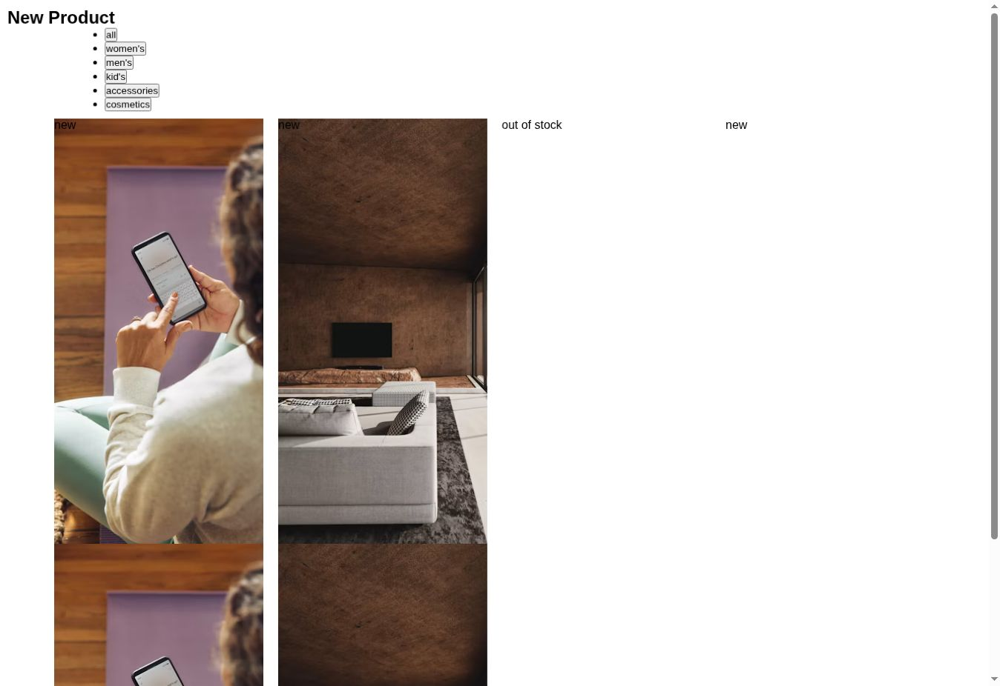

# Product Layout Practice

An HTML and CSS product-grid exercise. Category buttons are visual placeholders.

[Live demo](https://marvericklnk.github.io/LAYOUT_CLASS_SITE/)

## Run locally

Download the code and open `LAYOUT_CLASS_SITE/index.html` in your browser. You can also open the folder in VS Code and use Live Server.
